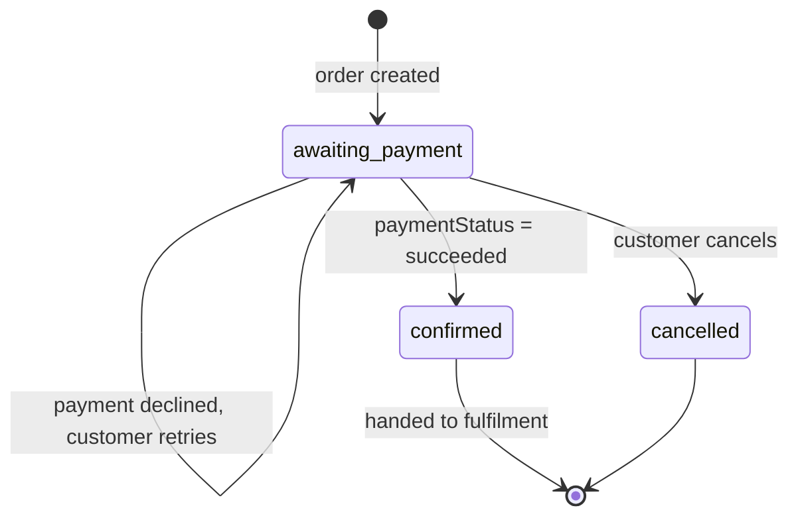
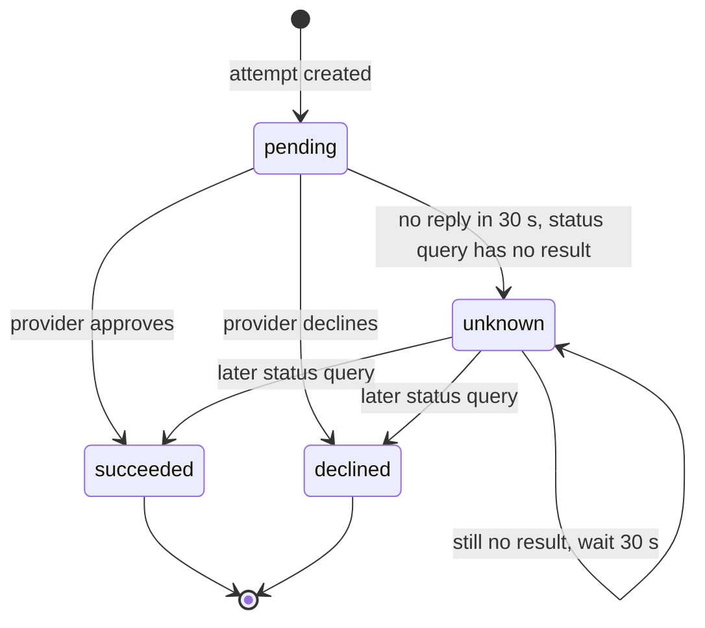

# Shared process data

Issue: [#31 / S2-05](https://github.com/sungurz/bristol-food-marketplace/issues/31) · Owner: Ahmet 

## Why this document exists

Our checkout and payment processes are built by different people, in different models, with different workers behind them. They only work together if everyone means the same thing by the same name. If one model writes `paymentStatus` and another checks `paymentOutcome`, both look fine on their own and the order still gets stuck between them.

This document is the one place where we agree those names: what each variable is called, what values it can hold, which states an order moves through, and what is passed along at each handover.

It covers Use Case 2, as split in the [functional scope](two-major-functionalities-scope.md):

- **Functionality A – Checkout and order creation.** [Checkout diagram](../Diagrams/Checkout%20diagram.bpmn) (#29).
- **Functionality B – Payment and commission.** [S2-04 model](../Diagrams/S2-04_Payment_and_Order_Confirmation_Operational.bpmn) (#30) and [S2-09 test payment](../Diagrams/s2-09-test-payment.bpmn) (#35).

### How this document is organised

It is deliberately split in three, so nobody mistakes a plan for something that works today.

| Part | Sections | What it contains |
|---|---|---|
| **Sprint 2 shared data** | 1 to 6 | What our models and workers use now, plus the few names they still need. This is what issue #31 asks for. |
| **Planned for Sprint 3** | 7 | Changes the group intends to make. **None of them is implemented.** |
| **Open decisions** | 8 | Questions nobody has answered yet. |

In the tables, the "Status" column says **In use** when a committed model or worker already uses the name exactly as written, and **To add** when it is defined here but nothing writes it yet.

## 1. Naming rules

| Rule | Example |
|---|---|
| Variables are written in camelCase. | `orderId`, `paymentAttemptId` |
| Status and decision values are lowercase, with an underscore between words. | `succeeded`, `awaiting_payment` |
| Error codes raised by workers are in capitals with underscores. | `STOCK_CHECK_UNAVAILABLE` |
| IDs are text, never empty, and compared exactly. | `ORD-1001`, `farm-a` |
| Money is a whole number of pence, in a variable ending in `InPence`. Decimals cause rounding errors, so we never use them. | `amountInPence: 1600` is £16.00 |
| Quantities are whole units, always more than zero. | `quantity: 2` |
| Dates and times use ISO 8601 in UTC. | `2026-11-19T10:00:00Z` |
| Yes/no values are real booleans. | `retryPayment = true` |
| Each idea has one name. The payment result is `paymentStatus`, never `paymentOutcome` or `paymentResult`. | |
| All sample data is made up. No real names, addresses or card details appear in variables, Forms or examples. | `customerId: "CUS-205"` |

## 2. Variable dictionary

"Written by" is the only step allowed to set a variable. Everything under "Read by" may use it but must not change it.

### 2.1 Checkout and order creation (Functionality A)

| Variable | Type | What it means and what it may hold | Written by | Read by | Status |
|---|---|---|---|---|---|
| `customerId` | String | The customer placing the order. | Checkout start | Order creation, notifications | To add |
| `basket` | Object | The customer's basket. Holds `items`. | Checkout start; Form `brfn-checkout-amend` | `validate-stock`, `prepare-fulfilment` | In use |
| `basket.items[]` | List | One row per product: `producerId`, `productId`, `quantity`. Never empty. | Same as `basket` | Same as `basket` | In use |
| `producerId` | String | A producer, e.g. `farm-a`. | Product catalogue | Every process | In use |
| `productId` | String | One producer's product, e.g. `apples`. Unique together with `producerId`. | Product catalogue | Stock check, order creation, stock update | In use |
| `quantity` | Integer | Units wanted. Whole number above zero. | Customer | Stock check, order creation, stock update | In use |
| `stockValidation` | Object | Result of the stock check: `canCheckout` and `errors`. Each check replaces the whole result. | `validate-stock` worker only | Gateway "Are all items and amounts available?"; amend Form | In use |
| `stockValidation.canCheckout` | Boolean | True only if every item is available in the amount requested. One failing item blocks the whole checkout. | `validate-stock` | Gateway | In use |
| `stockValidation.errors[].code` | String | Why an item failed: `EMPTY_BASKET`, `INVALID_BASKET`, `INVALID_ITEM`, `INVALID_QUANTITY`, `PRODUCT_NOT_FOUND`, `PRODUCT_UNAVAILABLE`, `INSUFFICIENT_STOCK`, `INVALID_STOCK_DATA`. | `validate-stock` | Amend Form | In use |
| `stockRetry` | Boolean | The customer's choice when the stock service is down. True means try again; anything else cancels. | Form `brfn-checkout-stock-recovery` | Gateway "Try again?" | In use |
| `producers` | List | The producers in this basket, each appearing once, with their items and the fulfilment methods they offer. | `prepare-fulfilment` | Fulfilment Form; order-creation loop | In use (contents to agree with #33) |
| `producer` | Object | One entry of `producers` inside the order-creation loop. | Loop | `create-producer-order` | In use |
| `fulfilmentSelections` | List | The customer's choice for each producer: `producerId`, `fulfilmentMethod`, `scheduledFor`. | Form `brfn-checkout-fulfilment` | `validate-fulfilment`, order creation | In use (contents to agree with #33) |
| `fulfilmentMethod` | String | `delivery` or `collection`. | Customer | Order creation, producer notification | To add |
| `scheduledFor` | Date-time | When the delivery or collection is due. Must be at least 48 hours after the moment `validate-fulfilment` checks it, using the server's clock. | Customer | `validate-fulfilment`, producer | To add |
| `fulfilmentValidation` | Object | Result of checking the choices and the 48-hour rule: `isValid` and `errors`. | `validate-fulfilment` | Gateway "Are the choices and times OK?" | In use |
| `checkoutDecision` | String | The customer's decision on the review Form: `confirm`, `amend` or `cancel`. Anything that is not `confirm` or `amend` counts as cancel. | Form `brfn-checkout-review` | Gateway "What does the customer choose?" | In use |
| `orderId` | String | The customer's overall order. All customer messages are matched on it. Created once, never replaced on a retry. | `create-marketplace-order` | Every later step | In use |
| `orderCreatedAt` | Date-time | When the order was created, from the server's clock. | `create-marketplace-order` | Records | To add |
| `orderStatus` | String | Where the order is in its life. See [section 3.1](#31-overall-order-orderstatus). | Order creation, then the payment process | Every process | To add |
| `producerOrder` | Object | One producer's share of the order. See section 2.3. | `create-producer-order` | Collected into `producerOrders` | In use |
| `producerOrders` | List | Every producer's share. One per producer, never empty. | Order-creation loop | Payment, commission, producer notification | In use |
| `amountInPence` | Integer | The total the customer pays. Equals all `producerSubtotalInPence` added together. | `create-marketplace-order` | Payment request | In use |

### 2.2 Payment and commission (Functionality B)

| Variable | Type | What it means and what it may hold | Written by | Read by | Status |
|---|---|---|---|---|---|
| `testScenario` | String | The outcome the sandbox should simulate: `approve`, `decline` or `outage`. It stands in for card details, which we never collect. | Customer payment Form | Sandbox gateway "Test scenario?" | In use |
| `paymentAttemptId` | String | One attempt at paying. Provider replies are matched on it. A retry gets a new one; a status query reuses the same one. | "Create and persist payment attempt ID" | Payment request, status query, worker | In use |
| `paymentStatus` | String | The result of the current attempt. See [section 3.3](#33-payment-attempt-paymentstatus). | Sandbox provider / `simulate-payment` worker | Gateway "Payment result?" | In use |
| `paymentReference` | String | The provider's reference for a successful payment. Always supplied by the provider; the marketplace never builds it. Empty (`null`) until a payment succeeds. | Sandbox provider / `simulate-payment` worker | Order record, confirmation | In use |
| `paymentProvider` | String | Who handled the payment. Always `simulated`. | Sandbox provider / `simulate-payment` worker | Order record | In use |
| `retryPayment` | Boolean | The customer's choice after a decline. True means try again; anything else cancels the order. | Customer Form "Choose retry or cancel" | Gateway "Retry?" | In use |
| `commissionTotalInPence` | Integer | BRFN's commission on the whole order: all `commissionInPence` added together. | "Calculate 5% commission and producer allocations" | Records | To add |

### 2.3 What one producer order contains

| Field | Type | What it means and what it may hold | Status |
|---|---|---|---|
| `producerOrderId` | String | One producer's share of an order, e.g. `PO-1001-A`. | To add |
| `orderId` | String | The overall order it belongs to. | In use |
| `producerId` | String | The producer who fulfils it. Appears once per order. | In use |
| `producerOrderStatus` | String | See [section 3.2](#32-producer-order-producerorderstatus). | To add |
| `fulfilmentMethod`, `scheduledFor` | String, Date-time | Copied from the customer's `fulfilmentSelections`. | To add |
| `items[]` | List | `productId`, `quantity`, `unitPriceInPence`, `lineTotalInPence`. Line total = quantity × unit price. Prices come from the catalogue, never from a Form. | To add |
| `producerSubtotalInPence` | Integer | The value of this producer's items. | To add |
| `commissionInPence` | Integer | 5% of the subtotal, rounded half up to a whole penny. Filled in only after payment succeeds. | To add |
| `producerPayoutInPence` | Integer | Subtotal minus commission. | To add |

### 2.4 The trusted stock record

This is not a process variable. The stock worker reads it from its own trusted source and ignores stock figures sent by a Form.

| Field | Type | What it means | Status |
|---|---|---|---|
| `producerId`, `productId` | String | Which product this is. | In use |
| `availableQuantity` | Integer, zero or more | Units that can be ordered. | In use |
| `isAvailable` | Boolean | Whether the product can be ordered now, including whether it is in season. | In use |
| `name` | String, optional | The name shown to customers. | In use |

## 3. States

Three things have a state: the overall order, each producer's share of it, and each attempt to pay. They are kept apart on purpose. "The payment was declined" is a fact about one attempt, not about the order.

### 3.1 Overall order: `orderStatus`

| Value | What it means | Becomes this when | Can move to |
|---|---|---|---|
| `awaiting_payment` | The order and its producer orders exist; nothing has been paid. | "Make main order – Waiting for payment" finishes. | `confirmed`, `cancelled` |
| `confirmed` | Payment succeeded and the order is accepted. | "Confirm overall order and linked producer orders" finishes. | Fulfilment (Sprint 3) |
| `cancelled` | The customer cancelled before paying. | "Close pending overall and producer orders" finishes. | Nothing; final. |



- **There is no order until the customer confirms.** Cancelling during checkout simply ends the process. No `orderId` exists, so there is no "draft" or "failed" state.
- **A declined payment leaves the order alone.** It stays `awaiting_payment` until the customer pays or cancels.
- **A confirmed order cannot be cancelled.** The functional scope (#13) puts refunds and cancelling a paid order out of scope.
- **Fulfilment states come later.** Preparing, ready and completed will be defined under S3-03.

### 3.2 Producer order: `producerOrderStatus`

It uses the same three values and always matches the overall order. The customer pays for the order as a whole, so in Sprint 2 two producer orders of one order are never in different states.

### 3.3 Payment attempt: `paymentStatus`

| Value | What it means | What the marketplace does next | Status |
|---|---|---|---|
| `pending` | The attempt exists but has no final result. | Waits for the provider. | To add |
| `succeeded` | The test payment was approved. | Records the payment, calculates commission, confirms the orders, updates stock, sends notifications. | In use |
| `declined` | The test payment was refused. | Tells the customer and waits for them to retry or cancel. | In use |
| `unknown` | The provider answered a status query but has no final result. | Waits 30 seconds and asks about the **same** attempt again. It never starts a new charge. | In use |



`succeeded` and `declined` are final. A retry after a decline is a new attempt with a new `paymentAttemptId`.

**If the first reply was lost.** When a status query reports `succeeded`, the reply must also carry `paymentReference` and `paymentProvider`, just as the original reply would have. The marketplace must not guess the reference from the attempt ID. The S2-04 model does not show this yet (see section 6).

### 3.4 Stock

Stock has no status variable. What the models do today:

1. Checkout **checks** stock. Nothing is reserved.
2. Stock is **deducted** after a successful payment, by "Update inventory without duplicate deduction".
3. A declined payment or a cancellation therefore needs no stock to be restored.

**Known limits of this.** Two customers can both pass the stock check for the last item, and nothing yet guarantees that a repeated job deducts only once. Both are Sprint 3 work; see section 7.

## 4. Process handoffs

Each row is a point where one participant or process passes work to another.

| # | Trigger | From → To | Carried by | Data sent | If it works | If it does not |
|---|---|---|---|---|---|---|
| 1 | Customer starts checkout | Customer → Checkout process | Process start | `customerId`, `basket` | The process starts. | — |
| 2 | Checkout starts, or the basket is changed | Checkout → Stock service | Job `validate-stock` | `basket` | `stockValidation.canCheckout = true` | `false` with `errors`: the customer changes the basket. Service down: `STOCK_CHECK_UNAVAILABLE`, then `stockRetry`. |
| 3 | Stock is approved | Checkout → Fulfilment preparation | Job `prepare-fulfilment` | `basket` | `producers` | Incident after retries. |
| 4 | Customer chooses arrangements | Customer → Checkout | Form `brfn-checkout-fulfilment`, then job `validate-fulfilment` | `fulfilmentSelections` | `fulfilmentValidation.isValid = true` | `false`: the customer changes their choices. |
| 5 | Customer reviews the order | Customer → Checkout | Form `brfn-checkout-review` | `checkoutDecision` | `confirm`: orders are created. | `amend`: back to the stock check. `cancel`: the process ends, no order. |
| 6 | Customer confirms | Checkout → Order service | Jobs `create-marketplace-order`, then `create-producer-order` per `producer` | `customerId`, `basket`, `fulfilmentSelections`; per producer, `orderId` and `producer` | `orderId`, `orderCreatedAt`, `orderStatus = "awaiting_payment"`, `amountInPence`, `producerOrders` | Incident. |
| 7 | All producer orders exist | Checkout process → Payment process | Job `handoff-payment`, message `brfn.pending-order-ready` | `orderId`, `customerId`, `amountInPence`, `orderStatus`, `producerOrders` | The payment process starts for this `orderId`. | **Not connected yet; see below.** |
| 8 | Customer submits a test payment | Customer → Marketplace | Message `PaymentDetails`, matched on `orderId` | `orderId`, `testScenario` | The marketplace creates a `paymentAttemptId`. | — |
| 9 | Attempt ID is stored | Marketplace → Sandbox provider | "Sandbox payment request" / job `simulate-payment` | `orderId`, `paymentAttemptId`, `amountInPence`, `testScenario` | Message `ProviderResult`, matched on `paymentAttemptId`: `paymentStatus`, `paymentReference`, `paymentProvider` | No reply in 30 seconds: handoff 10. |
| 10 | No reply, or no final result | Marketplace → Sandbox provider | "Query same attempt" | `paymentAttemptId` | Message `StatusResult`, matched on `paymentAttemptId`: `paymentStatus`, plus `paymentReference` and `paymentProvider` when it succeeded | `unknown` or no answer: wait 30 seconds, ask again. |
| 11 | `paymentStatus = "declined"` | Marketplace → Customer | Message `Decline`, matched on `orderId` | `orderId`, `paymentStatus` | `retryPayment = true`: handoff 8 with a new attempt. | Customer cancels: handoff 12. |
| 12 | Customer cancels | Customer → Marketplace → Customer | Messages `Cancellation`, then `Cancelled`, matched on `orderId` | `orderId` | `orderStatus` and every `producerOrderStatus` become `cancelled`; the customer gets an acknowledgement. | — |
| 13 | `paymentStatus = "succeeded"` | Inside the marketplace | Jobs `b-record`, `b-commission`, `b-confirm`, `b-inventory` | `orderId`, `paymentReference`, `producerOrders` | Commission is filled in, statuses become `confirmed`, stock is deducted. | Incident. |
| 14 | Order is confirmed | Marketplace → Customer | Message `ConfirmationConfirmed`, matched on `orderId` | `orderId`, `orderStatus`, `amountInPence`, `paymentReference`, fulfilment details | The customer reads the confirmation. | The notification is retried. |
| 15 | Order is confirmed | Marketplace → each Producer | One message per `producerOrder` | That producer's whole producer order (section 2.3) | The producer records the order for fulfilment. | The notification is retried. |

**Handoff 7 does not work yet.** Checkout publishes `brfn.pending-order-ready`, but the S2-04 payment process begins with a plain start event, so nothing receives it. Connecting them is integration work under #37.

**What a producer sees.** Only their own producer order: never another producer's items, and nothing about the customer's payment.

## 5. Sample data

Both examples use the same basket and the stock in `examples/stock-catalogue.json`: three units of apples at `farm-a` and four of bread at `farm-b`.

### 5.1 A successful order from two producers

A customer orders two apples from `farm-a`, to be delivered, and one bread from `farm-b`, to be collected. The test payment is approved first time.

| Producer | Items | Subtotal | 5% commission | Payout |
|---|---|---|---|---|
| `farm-a` (delivery) | 2 × apples at £6.00 | 1200p | 60p | 1140p |
| `farm-b` (collection) | 1 × bread at £4.00 | 400p | 20p | 380p |
| **Order `ORD-1001`** | | **1600p** | **80p** | **1520p** |

Checked by hand: 1200 + 400 = 1600, the amount charged. 60 + 20 = 80, the order's commission. 1140 + 380 + 80 = 1600. Stock afterwards: apples 3 → 1, bread 4 → 3. Both times are three days ahead, well over 48 hours.

These are the process variables at the end of the payment process. The complete file, [order-success.json](examples/order-success.json), adds the stock before and after and the notifications sent.

```json
{
  "orderId": "ORD-1001",
  "customerId": "CUS-205",
  "basket": {
    "items": [
      { "producerId": "farm-a", "productId": "apples", "quantity": 2 },
      { "producerId": "farm-b", "productId": "bread", "quantity": 1 }
    ]
  },
  "stockValidation": { "canCheckout": true, "errors": [] },
  "fulfilmentSelections": [
    { "producerId": "farm-a", "fulfilmentMethod": "delivery", "scheduledFor": "2026-11-19T10:00:00Z" },
    { "producerId": "farm-b", "fulfilmentMethod": "collection", "scheduledFor": "2026-11-19T14:00:00Z" }
  ],
  "fulfilmentValidation": { "isValid": true, "errors": [] },
  "checkoutDecision": "confirm",
  "orderCreatedAt": "2026-11-16T10:00:00Z",
  "orderStatus": "confirmed",
  "amountInPence": 1600,
  "testScenario": "approve",
  "paymentAttemptId": "ATTEMPT-1001-1",
  "paymentStatus": "succeeded",
  "paymentReference": "SIM-ATTEMPT-1001-1",
  "paymentProvider": "simulated",
  "commissionTotalInPence": 80,
  "producerOrders": [
    {
      "producerOrderId": "PO-1001-A",
      "orderId": "ORD-1001",
      "producerId": "farm-a",
      "producerOrderStatus": "confirmed",
      "fulfilmentMethod": "delivery",
      "scheduledFor": "2026-11-19T10:00:00Z",
      "items": [{"productId": "apples", "quantity": 2, "unitPriceInPence": 600, "lineTotalInPence": 1200}],
      "producerSubtotalInPence": 1200,
      "commissionInPence": 60,
      "producerPayoutInPence": 1140
    },
    {
      "producerOrderId": "PO-1001-B",
      "orderId": "ORD-1001",
      "producerId": "farm-b",
      "producerOrderStatus": "confirmed",
      "fulfilmentMethod": "collection",
      "scheduledFor": "2026-11-19T14:00:00Z",
      "items": [{"productId": "bread", "quantity": 1, "unitPriceInPence": 400, "lineTotalInPence": 400}],
      "producerSubtotalInPence": 400,
      "commissionInPence": 20,
      "producerPayoutInPence": 380
    }
  ]
}
```

### 5.2 A declined payment

The same basket as order `ORD-1002`, but the sandbox declines the payment. The variables that differ:

```json
{
  "orderId": "ORD-1002",
  "orderStatus": "awaiting_payment",
  "amountInPence": 1600,
  "testScenario": "decline",
  "paymentAttemptId": "ATTEMPT-1002-1",
  "paymentStatus": "declined",
  "paymentReference": null
}
```

Nothing else moves. The order stays open, both producer orders stay `awaiting_payment`, stock is untouched, no commission is calculated and no producer hears about it. The complete file is [payment-failed.json](examples/payment-failed.json).

### 5.3 Other situations

| Situation | What happens | What we expect |
|---|---|---|
| Payment declined, customer retries | `retryPayment = true`, then `testScenario = "approve"` | A new attempt, `ATTEMPT-1002-2`, on the same `orderId`. Ends like 5.1. |
| Payment declined, customer cancels | `retryPayment = false` | The order and both producer orders become `cancelled`. No stock change, no refund, no producer notification. |
| Payment service outage | `testScenario = "outage"`: no reply in 30 seconds | The marketplace queries the same `paymentAttemptId`. `unknown`: wait 30 seconds and ask again. `succeeded`: confirm as in 5.1, using the reference from the reply. No second charge. |
| Not enough stock | The basket asks for 5 apples; 3 are available | `stockValidation.canCheckout = false` with `INSUFFICIENT_STOCK`. Checkout waits until the basket is changed. No order is created. |
| Stock service down | The stock source cannot be read | `STOCK_CHECK_UNAVAILABLE`. The customer chooses `stockRetry`. No order is created. |
| Customer cancels at review | `checkoutDecision = "cancel"` | Checkout ends. No `orderId`, no order state. |
| Time chosen is too soon | `scheduledFor` is 24 hours away | `fulfilmentValidation.isValid = false`. The customer picks a later time. |

## 6. Consistency check against the models

The acceptance criterion asks that the data is used consistently, not only written down. On 15 November 2026 I compared this document with the models and workers on `main` and with the stock-validation branch (PR #42).

### What already matches

| Model point | Variables used | Matches? |
|---|---|---|
| Checkout: gateway "Are all items and amounts available?" | `stockValidation.canCheckout = true` | Yes |
| Checkout: gateway "Try again?" | `stockRetry = true` | Yes |
| Checkout: gateway "Are the choices and times OK?" | `fulfilmentValidation.isValid = true` | Yes |
| Checkout: gateway "What does the customer choose?" | `checkoutDecision` = `"confirm"` / `"amend"` | Yes |
| Checkout: producer-order loop | `producers` → `producer` → `producerOrder` → `producerOrders`, with `orderId` | Yes |
| Stock worker (PR #42) | `basket.items`, `stockValidation`, `STOCK_CHECK_UNAVAILABLE` | Yes |
| S2-04: gateway "Payment result?" | `paymentStatus` = `"succeeded"` / `"declined"` | Yes |
| S2-04: gateway "Test scenario?" | `testScenario` = `"approve"` / `"decline"` / `"outage"` | Yes |
| S2-04: gateway "Retry?" | `retryPayment = true` | Yes |
| S2-04: message matching | `orderId` for customer messages, `paymentAttemptId` for provider replies | Yes |
| S2-09 worker | Takes `orderId`, `paymentAttemptId`, `amountInPence`; returns `paymentStatus`, `paymentReference`, `paymentProvider` | Yes |


